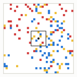

# Bean World

This environment is part of the [Native continual worlds](families/native.md) family; its page lists the install command and the family's other environments.

| | |
|---|---|
| Creation | `pp.make("BeanWorld-v0")` |
| Install | `uv sync --locked` |
| Actions | Discrete |
| Agents | `1` |
| Action Shape | `(1,)` |
| Action Values | `Discrete(5)` per agent |
| Observation Shape | `(1, 150)` |
| Observation Values | `[0, inf)` |
| Execution | `jax` |
| Checkpointable | yes |
| Backend | `native JAX` |
| Default drift | `stationary` |
| Driftable parameters | `item_rewards`, `regrow_ticks` |
| Default drift field | `item_rewards` |
| Privileged (Oracle) | `task_id`, `boundary`, drift values ([all](#privileged-fields)) |

A never-ending foraging world in the style of Jelly Bean World (Platanios et al., 2020; a new JAX implementation, not a port). A seeded torus holds jelly beans, bananas and onions in banded biomes, so what an agent finds changes as it explores; collected items regrow after a per-type delay.



*A 33-by-33 part of the world around the agent (black) after a few random ticks. Jelly beans are blue, bananas yellow and onions red; the box is the agent's 7-by-7 view.*

## Definition

### Observation Space

float32 `(agents, view*view*3 + 3)` (`view` is 7 by default, so 150 values). The first `view*view*3` values are the egocentric item window, flattened row-major with the item type as the fastest axis: reshape them to `(view, view, 3)` as (row, column, item), not `(3, view, view)`. The agent is at the centre and row 0 is the top (the up action moves to the previous row). Items are ordered jelly bean, banana, onion. The last three values are the per-item scent in the same order: the sum over the `(2*scent_radius+1)`-square around the agent of present items weighted by `1/(1+Manhattan distance)`. It is not normalised to [0, 1]; at the default `scent_radius` of 8 it is at most about 37.6 per item.

### Action Space

Integer `(agents,)`: stay/up/down/left/right, always valid on the torus.

### Rewards

float32 `(agents,)`: the item's reward when stepping onto one (defaults: jelly bean +1, banana +0.1, onion -1).

### Initial State

A seeded layout; agents spawn uniformly.

### Respawns

None: agents never die or respawn.

### Drift

`item_rewards` and `regrow_ticks` (per item type), hidden unless an Oracle exposes them.

## Arguments

| Argument | Default |
|---|---|
| `size` | `128` |
| `num_agents` | `1` |
| `view` | `7` |
| `scent_radius` | `8` |
| `densities` | `(0.06, 0.04, 0.04)` |
| `biome_wavelength` | `32.0` |
| `drift` | `None` |

## Usage

```python
import jax
import perpetua as pp

env = pp.make("BeanWorld-v0")
state, obs, info = env.init(jax.random.key(0))
for tick in range(4):
    action = pp.policies.random(obs, info, jax.random.key(100 + tick))
    state, obs, reward, info = env.step(state, action, jax.random.key(1000 + tick))
print(obs.shape, reward, info["t"].to_int())

# Make it non-stationary: `item_rewards` alternates between two values every 1,000 ticks.
drifting = pp.make(
    "BeanWorld-v0",
    drift={"item_rewards": pp.drift.Cyclic([(1, 0.1, -1), (-1, -0.1, 1)], period=1000)},
)
state, obs, info = drifting.init(jax.random.key(0))
```

## Limits

Agents that step onto the same item on the same tick each receive it.

## Privileged fields

Hidden from the agent; expose any of them with `pp.Oracle(env, expose=["task_id", ...])`, which records the choice in `metadata["oracle_exposure"]`.

| Field | Meaning |
|---|---|
| `phase` | the drift phase: an integer that changes at every declared switch (for `Cyclic`, the index of the current value) |
| `drift_parameters` | the current value of the default drifting parameter |
| `drift_changed` | deprecated alias of `boundary` |
| `task_id` | the active task: the task index under a task switch, the regime under MORPHEUS, otherwise the phase of the default drifting parameter |
| `boundary` | whether a declared switch happened on this tick (the name task-sequence protocols use, for example SAC's `task_boundary_reset`) |
| `item_rewards_parameters`, `item_rewards_phase`, `item_rewards_changed` | the current value, phase and switch flag of `item_rewards` |
| `regrow_ticks_parameters`, `regrow_ticks_phase`, `regrow_ticks_changed` | the current value, phase and switch flag of `regrow_ticks` |

## Version History

- `v0`: initial release.

## API

```{eval-rst}
.. autoclass:: perpetua.envs.bean_world.BeanWorld
   :no-index:
```
