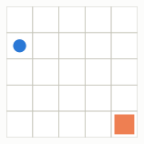

# Continual Grid

This environment is part of the [Native continual worlds](families/native.md) family; its page lists the install command and the family's other environments.

| | |
|---|---|
| Creation | `pp.make("ContinualGrid-v0")` |
| Install | `uv sync --locked` |
| Actions | Discrete |
| Agents | `1` |
| Action Shape | `(1,)` |
| Action Values | `Discrete(5)` per agent |
| Observation Shape | `(1, 4)` |
| Observation Values | `[0, 1]` |
| Execution | `jax` |
| Checkpointable | yes |
| Backend | `native JAX` |
| Default drift | `stationary` |
| Driftable parameters | `goal` |
| Default drift field | `goal` |
| Privileged (Oracle) | `task_id`, `boundary`, drift values ([all](#privileged-fields)) |

Collect a shared goal for +1 and respawn inside the same lifetime. The goal is the drifting parameter, so the same world can be stationary, cyclic, a random walk or a procedural stream. Agents share the goal but do not collide.



*One frame after a few random ticks: the agent in blue and the goal in orange.*

## Definition

### Observation Space

float32 `(agents, 4)`: normalized row, column, goal row, goal column.

### Action Space

Integer `(agents,)`: stay/up/down/left/right = 0/1/2/3/4. Masked or invalid actions become stay.

### Rewards

float32 `(agents,)`: +1 on reaching the goal.

### Initial State

Agents spawn uniformly outside the goal cell.

### Respawns

An agent that collects respawns elsewhere on the same tick and `info['respawn']` reports it.

### Drift

`goal` (row, column), clipped to the grid and rounded to a cell, so drift smaller than half a cell never moves it.

## Arguments

| Argument | Default |
|---|---|
| `size` | `5` |
| `num_agents` | `1` |
| `drift` | `None` |

## Usage

```python
import jax
import perpetua as pp

env = pp.make("ContinualGrid-v0")
state, obs, info = env.init(jax.random.key(0))
for tick in range(4):
    action = pp.policies.random(obs, info, jax.random.key(100 + tick))
    state, obs, reward, info = env.step(state, action, jax.random.key(1000 + tick))
print(obs.shape, reward, info["t"].to_int())

# Make it non-stationary: `goal` alternates between two values every 1,000 ticks.
drifting = pp.make(
    "ContinualGrid-v0",
    drift={"goal": pp.drift.Cyclic([(4, 4), (0, 0)], period=1000)},
)
state, obs, info = drifting.init(jax.random.key(0))
```

## Limits

Non-interacting agents: a parallel-agent contract example, not a MARL benchmark.

## See also

The [Lifetimes and drift](../native-api.md) guide.

## Privileged fields

Hidden from the agent; expose any of them with `pp.Oracle(env, expose=["task_id", ...])`, which records the choice in `metadata["oracle_exposure"]`.

| Field | Meaning |
|---|---|
| `phase` | the drift phase: an integer that changes at every declared switch (for `Cyclic`, the index of the current value) |
| `drift_parameters` | the current value of the default drifting parameter |
| `drift_changed` | deprecated alias of `boundary` |
| `task_id` | the active task: the task index under a task switch, the regime under MORPHEUS, otherwise the phase of the default drifting parameter |
| `boundary` | whether a declared switch happened on this tick (the name task-sequence protocols use, for example SAC's `task_boundary_reset`) |
| `goal_parameters`, `goal_phase`, `goal_changed` | the current value, phase and switch flag of `goal` |

## Version History

- `v0`: initial release.

## API

```{eval-rst}
.. autoclass:: perpetua.envs.continual_grid.ContinualGrid
   :no-index:
```
