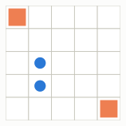

# Cooperative Grid

This environment is part of the [Multi-agent worlds](families/multi-agent.md) family; its page lists the install command and the family's other environments.

| | |
|---|---|
| Creation | `pp.make("CooperativeGrid-v0")` |
| Install | `uv sync --locked` |
| Actions | Discrete |
| Agents | `2` |
| Action Shape | `(2,)` |
| Action Values | `Discrete(5)` per agent |
| Observation Shape | `(2, 7)` |
| Observation Values | `[0, 1]` |
| Execution | `jax` |
| Checkpointable | yes |
| Backend | `native JAX` |
| Default drift | `stationary` |
| Driftable parameters | `goal` |
| Default drift field | `goal` |
| Privileged (Oracle) | `task_id`, `boundary`, drift values ([all](#privileged-fields)) |

A cooperative grid with real interaction: agents block one another, contend for free cells, and the whole team scores only when every active agent reaches its target.



*One frame after a few random ticks: the two agents in blue and each agent's target in orange.*

## Definition

### Observation Space

float32 `(agents, 4 + 3*(agents-1))`: own position and target, then each other slot's position and activity.

### Action Space

Integer `(agents,)`: stay/up/down/left/right = 0/1/2/3/4. Masked or invalid actions become stay.

### Rewards

float32 `(agents,)`: +1 each when all active agents reach their targets.

### Initial State

Unique spawns outside the targets.

### Respawns

After a joint collection every agent respawns uniquely.

### Drift

`goal`, the anchor of the consecutive row-major targets.

## Arguments

| Argument | Default |
|---|---|
| `size` | `5` |
| `num_agents` | `2` |
| `drift` | `None` |

## Usage

```python
import jax
import perpetua as pp

env = pp.make("CooperativeGrid-v0")
state, obs, info = env.init(jax.random.key(0))
for tick in range(4):
    action = pp.policies.random(obs, info, jax.random.key(100 + tick))
    state, obs, reward, info = env.step(state, action, jax.random.key(1000 + tick))
print(obs.shape, reward, info["t"].to_int())

# Make it non-stationary: `goal` alternates between two values every 1,000 ticks.
drifting = pp.make(
    "CooperativeGrid-v0",
    drift={"goal": pp.drift.Cyclic([(4, 4), (0, 0)], period=1000)},
)
state, obs, info = drifting.init(jax.random.key(0))
```

## See also

The [Multi-agent RL](../marl.md) guide.

## Privileged fields

Hidden from the agent; expose any of them with `pp.Oracle(env, expose=["task_id", ...])`, which records the choice in `metadata["oracle_exposure"]`.

| Field | Meaning |
|---|---|
| `phase` | the drift phase: an integer that changes at every declared switch (for `Cyclic`, the index of the current value) |
| `drift_parameters` | the current value of the default drifting parameter |
| `drift_changed` | deprecated alias of `boundary` |
| `task_id` | the active task: the task index under a task switch, the regime under MORPHEUS, otherwise the phase of the default drifting parameter |
| `boundary` | whether a declared switch happened on this tick (the name task-sequence protocols use, for example SAC's `task_boundary_reset`) |
| `goal_parameters`, `goal_phase`, `goal_changed` | the current value, phase and switch flag of `goal` |

## Version History

- `v0`: initial release.

## API

```{eval-rst}
.. autoclass:: perpetua.envs.cooperative_grid.CooperativeGrid
   :no-index:
```
