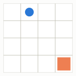

# Forager Grid

This environment is part of the [Native continual worlds](families/native.md) family; its page lists the install command and the family's other environments.

| | |
|---|---|
| Creation | `pp.make("ForagerGrid-v0")` |
| Install | `uv sync --locked` |
| Actions | Discrete |
| Agents | `1` |
| Action Shape | `(1,)` |
| Action Values | `Discrete(5)` per agent |
| Observation Shape | `(1, 4)` |
| Observation Values | `[0, 1]` |
| Execution | `jax` |
| Checkpointable | yes |
| Backend | `native JAX` |
| Default drift | `stationary` |
| Driftable parameters | `mass` |
| Default drift field | `mass` |
| Privileged (Oracle) | `task_id`, `boundary`, drift values ([all](#privileged-fields)) |

Agent-driven drift: collecting adds hidden mass, mass decays, and a move succeeds with probability `1 / mass`. The drift is caused by the agent's own behaviour (pair it with `pp.drift.Accumulate`).



*One frame after a few random ticks: the agent in blue and the goal in orange.*

## Definition

### Observation Space

float32 `(agents, 4)`: normalized row, column, goal row, goal column.

### Action Space

Integer `(agents,)`: stay/up/down/left/right = 0/1/2/3/4. Masked or invalid actions become stay.

### Rewards

float32 `(agents,)`: +1 on reaching the fixed bottom-right goal.

### Initial State

Agents start light (every move succeeds).

### Respawns

Collecting respawns the agent elsewhere on the same tick.

### Drift

`mass` per agent, fed by the environment's privileged collection signal; exposed only as the Oracle field `mass_parameters`. With `pp.drift.Accumulate`, each tick `mass = clip(decay * mass + gain * collected, low, high)`, so it stays at or below `max(low, gain / (1 - decay))` once the starting value has decayed to that bound; `low` is a floor, not a rest value.

## Arguments

| Argument | Default |
|---|---|
| `size` | `4` |
| `num_agents` | `1` |
| `max_mass` | `8.0` |
| `drift` | `None` |

## Usage

```python
import jax
import perpetua as pp

env = pp.make("ForagerGrid-v0")
state, obs, info = env.init(jax.random.key(0))
for tick in range(4):
    action = pp.policies.random(obs, info, jax.random.key(100 + tick))
    state, obs, reward, info = env.step(state, action, jax.random.key(1000 + tick))
print(obs.shape, reward, info["t"].to_int())

# Make it non-stationary: each collect adds 4 to `mass`, which then decays by 10% per tick.
drifting = pp.make(
    "ForagerGrid-v0",
    drift={"mass": pp.drift.Accumulate(gain=4.0, decay=0.9, low=1.0, high=8.0)},
)
state, obs, info = drifting.init(jax.random.key(0))
```

## Privileged fields

Hidden from the agent; expose any of them with `pp.Oracle(env, expose=["task_id", ...])`, which records the choice in `metadata["oracle_exposure"]`.

| Field | Meaning |
|---|---|
| `phase` | the drift phase: an integer that changes at every declared switch (for `Cyclic`, the index of the current value) |
| `drift_parameters` | the current value of the default drifting parameter |
| `drift_changed` | deprecated alias of `boundary` |
| `task_id` | the active task: the task index under a task switch, the regime under MORPHEUS, otherwise the phase of the default drifting parameter |
| `boundary` | whether a declared switch happened on this tick (the name task-sequence protocols use, for example SAC's `task_boundary_reset`) |
| `mass_parameters`, `mass_phase`, `mass_changed` | the current value, phase and switch flag of `mass` |

## Version History

- `v0`: initial release.

## API

```{eval-rst}
.. autoclass:: perpetua.envs.forager_grid.ForagerGrid
   :no-index:
```
