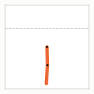

# Acrobot

This environment is part of the [Classic and MuJoCo control](families/control.md) family; its page lists the install command and the family's other environments.

| | |
|---|---|
| Creation | `pp.make("gymnax/Acrobot-v1")` |
| Install | `uv sync --locked --extra interop` |
| Actions | Discrete |
| Agents | `1` |
| Action Shape | `(1,)` |
| Action Values | `Discrete(3)` per agent |
| Observation Shape | `(1, 6)` |
| Observation Values | `[-28.2743, 28.2743]` |
| Execution | `jax` |
| Checkpointable | yes |
| Backend | `gymnax-0.0.9` |
| Default drift | `stationary` |
| Driftable parameters | `dt`, `link_com_pos_1`, `link_com_pos_2`, `link_length_1`, `link_mass_1`, `link_mass_2`, `link_moi`, `max_vel_1`, `max_vel_2`, `torque_noise_max` |
| Default drift field | `dt` |
| Privileged (Oracle) | `task_id`, `boundary`, drift values ([all](#privileged-fields)) |
| Upstream | [Gymnasium Acrobot](https://gymnasium.farama.org/environments/classic_control/acrobot/) |

gymnax's `Acrobot-v1` through the generic `GymnaxParameters` adapter.



*A drawing of the observation after 12 random ticks (positions and angles; not a simulator render).*

The observation, action and reward definitions are upstream's: see [Gymnasium Acrobot](https://gymnasium.farama.org/environments/classic_control/acrobot/). This page lists only what changes in Perpetua.

## What changes in Perpetua

### Rewards

The backend's reward, unchanged.

### Respawns

The backend time limit is removed; terminations become respawns inside the lifetime.

### Drift

Any float parameter listed under Driftable parameters, by name.

## Arguments

| Argument | Default |
|---|---|
| `drift_fields` | `None` |
| `drift` | `None` |

## Usage

```python
import jax
import perpetua as pp

env = pp.make("gymnax/Acrobot-v1")
state, obs, info = env.init(jax.random.key(0))
for tick in range(4):
    action = pp.policies.random(obs, info, jax.random.key(100 + tick))
    state, obs, reward, info = env.step(state, action, jax.random.key(1000 + tick))
print(obs.shape, reward, info["t"].to_int())

# Make it non-stationary: `dt` alternates between two values every 1,000 ticks.
drifting = pp.make(
    "gymnax/Acrobot-v1",
    drift={"dt": pp.drift.Cyclic([0.2, 0.1], period=1000)},
)
state, obs, info = drifting.init(jax.random.key(0))
```

## Limits

Actions are checked for shape and dtype (an integer array of shape `(1,)`), not for value: an index outside the action range reaches the backend as it is. Most backends look the index up in a table, so an index past the end acts as the last action and a negative one counts from the end; MountainCar scales the push with it. Clip in the policy.

## See also

The [Environment adapters and the CPU bridge](../adapters.md) guide.

## Privileged fields

Hidden from the agent; expose any of them with `pp.Oracle(env, expose=["task_id", ...])`, which records the choice in `metadata["oracle_exposure"]`.

| Field | Meaning |
|---|---|
| `phase` | the drift phase: an integer that changes at every declared switch (for `Cyclic`, the index of the current value) |
| `drift_parameters` | the current value of the default drifting parameter |
| `drift_changed` | deprecated alias of `boundary` |
| `task_id` | the active task: the task index under a task switch, the regime under MORPHEUS, otherwise the phase of the default drifting parameter |
| `boundary` | whether a declared switch happened on this tick (the name task-sequence protocols use, for example SAC's `task_boundary_reset`) |
| `dt_parameters`, `dt_phase`, `dt_changed` | the current value, phase and switch flag of `dt` |
| `link_com_pos_1_parameters`, `link_com_pos_1_phase`, `link_com_pos_1_changed` | the current value, phase and switch flag of `link_com_pos_1` |
| `link_com_pos_2_parameters`, `link_com_pos_2_phase`, `link_com_pos_2_changed` | the current value, phase and switch flag of `link_com_pos_2` |
| `link_length_1_parameters`, `link_length_1_phase`, `link_length_1_changed` | the current value, phase and switch flag of `link_length_1` |
| `link_mass_1_parameters`, `link_mass_1_phase`, `link_mass_1_changed` | the current value, phase and switch flag of `link_mass_1` |
| `link_mass_2_parameters`, `link_mass_2_phase`, `link_mass_2_changed` | the current value, phase and switch flag of `link_mass_2` |
| `link_moi_parameters`, `link_moi_phase`, `link_moi_changed` | the current value, phase and switch flag of `link_moi` |
| `max_vel_1_parameters`, `max_vel_1_phase`, `max_vel_1_changed` | the current value, phase and switch flag of `max_vel_1` |
| `max_vel_2_parameters`, `max_vel_2_phase`, `max_vel_2_changed` | the current value, phase and switch flag of `max_vel_2` |
| `torque_noise_max_parameters`, `torque_noise_max_phase`, `torque_noise_max_changed` | the current value, phase and switch flag of `torque_noise_max` |
| `<name>_parameters`, `<name>_phase`, `<name>_changed` for `available_torque`, `link_length_2` | constants: the backend's value of each field, phase 0, never changed; `drift=` rejects these fields |
| `max_steps_in_episode_parameters`, `max_steps_in_episode_phase`, `max_steps_in_episode_changed` | the backend's original time limit, as a constant; the adapter removes the limit, so it is not enforced |

## Version History

- `v1`: wraps gymnax 0.0.9; the version follows gymnax's id.

## API

```{eval-rst}
.. autoclass:: perpetua.adapters.gymnax_params.GymnaxParameters
   :no-index:
```
