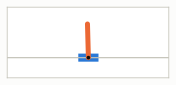

# CartPole

This environment is part of the [Classic and MuJoCo control](families/control.md) family; its page lists the install command and the family's other environments.

| | |
|---|---|
| Creation | `pp.make("gymnax/CartPole-v1")` |
| Install | `uv sync --locked --extra interop` |
| Actions | Discrete |
| Agents | `1` |
| Action Shape | `(1,)` |
| Action Values | `Discrete(2)` per agent |
| Observation Shape | `(1, 4)` |
| Observation Values | `[-3.40282e+38, 3.40282e+38]` |
| Execution | `jax` |
| Checkpointable | yes |
| Backend | `gymnax-0.0.9` |
| Default drift | `stationary` |
| Driftable parameters | `gravity` |
| Default drift field | `gravity` |
| Privileged (Oracle) | `task_id`, `boundary`, drift values ([all](#privileged-fields)) |
| Upstream | [Gymnasium CartPole](https://gymnasium.farama.org/environments/classic_control/cart_pole/) |

gymnax CartPole as a continuing lifetime with drifting gravity.



*A drawing of the observation after 12 random ticks (positions and angles; not a simulator render).*

The observation, action and reward definitions are upstream's: see [Gymnasium CartPole](https://gymnasium.farama.org/environments/classic_control/cart_pole/). This page lists only what changes in Perpetua.

## What changes in Perpetua

### Rewards

float32 `(1,)`: +1 per surviving tick; the failure tick scores zero.

### Respawns

A failure respawns the pole in place on the same tick.

### Drift

`gravity` (m/s², shape `(1,)`): write phases as tuples, e.g. `Cyclic([(9.8,), (12.0,)], 1000)`.

## Arguments

| Argument | Default |
|---|---|
| `drift` | `None` |

## Usage

```python
import jax
import perpetua as pp

env = pp.make("gymnax/CartPole-v1")
state, obs, info = env.init(jax.random.key(0))
for tick in range(4):
    action = pp.policies.random(obs, info, jax.random.key(100 + tick))
    state, obs, reward, info = env.step(state, action, jax.random.key(1000 + tick))
print(obs.shape, reward, info["t"].to_int())

# Make it non-stationary: `gravity` alternates between two values every 1,000 ticks.
drifting = pp.make(
    "gymnax/CartPole-v1",
    drift={"gravity": pp.drift.Cyclic([(9.8,), (4.9,)], period=1000)},
)
state, obs, info = drifting.init(jax.random.key(0))
```

## See also

The [Environment adapters and the CPU bridge](../adapters.md) guide.

## Privileged fields

Hidden from the agent; expose any of them with `pp.Oracle(env, expose=["task_id", ...])`, which records the choice in `metadata["oracle_exposure"]`.

| Field | Meaning |
|---|---|
| `phase` | the drift phase: an integer that changes at every declared switch (for `Cyclic`, the index of the current value) |
| `drift_parameters` | the current value of the default drifting parameter |
| `drift_changed` | deprecated alias of `boundary` |
| `task_id` | the active task: the task index under a task switch, the regime under MORPHEUS, otherwise the phase of the default drifting parameter |
| `boundary` | whether a declared switch happened on this tick (the name task-sequence protocols use, for example SAC's `task_boundary_reset`) |
| `gravity_parameters`, `gravity_phase`, `gravity_changed` | the current value, phase and switch flag of `gravity` |

## Version History

- `v1`: initial release.

## API

```{eval-rst}
.. autoclass:: perpetua.adapters.gymnax.GymnaxCartPole
   :no-index:
```
