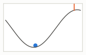

# Mountain Car Continuous

This environment is part of the [Classic and MuJoCo control](families/control.md) family; its page lists the install command and the family's other environments.

| | |
|---|---|
| Creation | `pp.make("gymnax/MountainCarContinuous-v0")` |
| Install | `uv sync --locked --extra interop` |
| Actions | Continuous |
| Agents | `1` |
| Action Shape | `(1, 1)` |
| Action Values | `[-1, 1]` |
| Observation Shape | `(1, 2)` |
| Observation Values | `[-1.2, 0.6]` |
| Execution | `jax` |
| Checkpointable | yes |
| Backend | `gymnax-0.0.9` |
| Default drift | `stationary` |
| Driftable parameters | `goal_position`, `goal_velocity`, `gravity`, `max_action`, `max_position`, `max_speed`, `min_action`, `min_position`, `power` |
| Default drift field | `min_action` |
| Privileged (Oracle) | `task_id`, `boundary`, drift values ([all](#privileged-fields)) |
| Upstream | [Gymnasium Continuous Mountain Car](https://gymnasium.farama.org/environments/classic_control/mountain_car_continuous/) |

gymnax's `MountainCarContinuous-v0` through the generic `GymnaxParameters` adapter.



*A drawing of the observation after 12 random ticks (positions and angles; not a simulator render).*

The observation, action and reward definitions are upstream's: see [Gymnasium Continuous Mountain Car](https://gymnasium.farama.org/environments/classic_control/mountain_car_continuous/). This page lists only what changes in Perpetua.

## What changes in Perpetua

### Rewards

The backend's reward, unchanged.

### Respawns

The backend time limit is removed; terminations become respawns inside the lifetime.

### Drift

Any float parameter listed under Driftable parameters, by name.

## Arguments

| Argument | Default |
|---|---|
| `drift_fields` | `None` |
| `drift` | `None` |

## Usage

```python
import jax
import jax.numpy as jnp
import perpetua as pp

env = pp.make("gymnax/MountainCarContinuous-v0")
state, obs, info = env.init(jax.random.key(0))
for tick in range(4):
    action = jnp.zeros(env.action_space.shape, dtype=jnp.float32)
    state, obs, reward, info = env.step(state, action, jax.random.key(1000 + tick))
print(obs.shape, reward, info["t"].to_int())

# Make it non-stationary: `min_action` alternates between two values every 1,000 ticks.
drifting = pp.make(
    "gymnax/MountainCarContinuous-v0",
    drift={"min_action": pp.drift.Cyclic([-1, -0.5], period=1000)},
)
state, obs, info = drifting.init(jax.random.key(0))
```

## Limits

Actions must be float arrays of the action space's shape, so `pp.policies.random` does not apply: sample with `pp.policies.uniform(env.action_space)`.

## See also

The [Environment adapters and the CPU bridge](../adapters.md) guide.

## Privileged fields

Hidden from the agent; expose any of them with `pp.Oracle(env, expose=["task_id", ...])`, which records the choice in `metadata["oracle_exposure"]`.

| Field | Meaning |
|---|---|
| `phase` | the drift phase: an integer that changes at every declared switch (for `Cyclic`, the index of the current value) |
| `drift_parameters` | the current value of the default drifting parameter |
| `drift_changed` | deprecated alias of `boundary` |
| `task_id` | the active task: the task index under a task switch, the regime under MORPHEUS, otherwise the phase of the default drifting parameter |
| `boundary` | whether a declared switch happened on this tick (the name task-sequence protocols use, for example SAC's `task_boundary_reset`) |
| `goal_position_parameters`, `goal_position_phase`, `goal_position_changed` | the current value, phase and switch flag of `goal_position` |
| `goal_velocity_parameters`, `goal_velocity_phase`, `goal_velocity_changed` | the current value, phase and switch flag of `goal_velocity` |
| `gravity_parameters`, `gravity_phase`, `gravity_changed` | the current value, phase and switch flag of `gravity` |
| `max_action_parameters`, `max_action_phase`, `max_action_changed` | the current value, phase and switch flag of `max_action` |
| `max_position_parameters`, `max_position_phase`, `max_position_changed` | the current value, phase and switch flag of `max_position` |
| `max_speed_parameters`, `max_speed_phase`, `max_speed_changed` | the current value, phase and switch flag of `max_speed` |
| `min_action_parameters`, `min_action_phase`, `min_action_changed` | the current value, phase and switch flag of `min_action` |
| `min_position_parameters`, `min_position_phase`, `min_position_changed` | the current value, phase and switch flag of `min_position` |
| `power_parameters`, `power_phase`, `power_changed` | the current value, phase and switch flag of `power` |
| `max_steps_in_episode_parameters`, `max_steps_in_episode_phase`, `max_steps_in_episode_changed` | the backend's original time limit, as a constant; the adapter removes the limit, so it is not enforced |

## Version History

- `v0`: wraps gymnax 0.0.9; the version follows gymnax's id.

## API

```{eval-rst}
.. autoclass:: perpetua.adapters.gymnax_params.GymnaxParameters
   :no-index:
```
