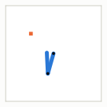

# Reacher (misc)

This environment is part of the [MinAtar, bsuite and misc (gymnax)](families/gymnax.md) family; its page lists the install command and the family's other environments.

| | |
|---|---|
| Creation | `pp.make("gymnax/Reacher-misc")` |
| Install | `uv sync --locked --extra interop` |
| Actions | Continuous |
| Agents | `1` |
| Action Shape | `(1, 2)` |
| Action Values | `[-1, 1]` |
| Observation Shape | `(1, 8)` |
| Observation Values | `[-3.40282e+38, 3.40282e+38]` |
| Execution | `jax` |
| Checkpointable | yes |
| Backend | `gymnax-0.0.9` |
| Default drift | `stationary` |
| Driftable parameters | `dt`, `torque_scale` |
| Default drift field | `torque_scale` |
| Privileged (Oracle) | `task_id`, `boundary`, drift values ([all](#privileged-fields)) |
| Upstream | [gymnax](https://github.com/RobertTLange/gymnax) |

gymnax's `Reacher-misc` through the generic `GymnaxParameters` adapter.



*A drawing of the state after 12 random ticks: the two links in blue and the goal in orange.*

## Definition

### Observation Space

float32 `(1, 8)`: the cosines of the two joint angles, their sines, the two joint velocities, then the goal's x and y.

### Action Space

float32 `(1, 2)` in [-1, 1]: the two joint accelerations, multiplied by `torque_scale`.

### Rewards

float32 `(1,)`: `exp(-d**2)`, where d is the distance from the arm's tip to the goal, so in (0, 1].

### Respawns

None: the backend ends an episode only at its time limit, which is removed, so there is never a respawn.

### Drift

Any float parameter listed under Driftable parameters, by name.

## Arguments

| Argument | Default |
|---|---|
| `drift_fields` | `None` |
| `drift` | `None` |

## Usage

```python
import jax
import jax.numpy as jnp
import perpetua as pp

env = pp.make("gymnax/Reacher-misc")
state, obs, info = env.init(jax.random.key(0))
for tick in range(4):
    action = jnp.zeros(env.action_space.shape, dtype=jnp.float32)
    state, obs, reward, info = env.step(state, action, jax.random.key(1000 + tick))
print(obs.shape, reward, info["t"].to_int())

# Make it non-stationary: `torque_scale` alternates between two values every 1,000 ticks.
drifting = pp.make(
    "gymnax/Reacher-misc",
    drift={"torque_scale": pp.drift.Cyclic([1, 0.5], period=1000)},
)
state, obs, info = drifting.init(jax.random.key(0))
```

## Limits

Actions must be float arrays of the action space's shape, so `pp.policies.random` does not apply: sample with `pp.policies.uniform(env.action_space)`.

## See also

The [Environment adapters and the CPU bridge](../adapters.md) guide.

## Privileged fields

Hidden from the agent; expose any of them with `pp.Oracle(env, expose=["task_id", ...])`, which records the choice in `metadata["oracle_exposure"]`.

| Field | Meaning |
|---|---|
| `phase` | the drift phase: an integer that changes at every declared switch (for `Cyclic`, the index of the current value) |
| `drift_parameters` | the current value of the default drifting parameter |
| `drift_changed` | deprecated alias of `boundary` |
| `task_id` | the active task: the task index under a task switch, the regime under MORPHEUS, otherwise the phase of the default drifting parameter |
| `boundary` | whether a declared switch happened on this tick (the name task-sequence protocols use, for example SAC's `task_boundary_reset`) |
| `dt_parameters`, `dt_phase`, `dt_changed` | the current value, phase and switch flag of `dt` |
| `torque_scale_parameters`, `torque_scale_phase`, `torque_scale_changed` | the current value, phase and switch flag of `torque_scale` |
| `max_steps_in_episode_parameters`, `max_steps_in_episode_phase`, `max_steps_in_episode_changed` | the backend's original time limit, as a constant; the adapter removes the limit, so it is not enforced |

## Version History

- `v0`: wraps gymnax 0.0.9; the version follows gymnax's id.

## API

```{eval-rst}
.. autoclass:: perpetua.adapters.gymnax_params.GymnaxParameters
   :no-index:
```
