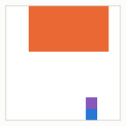

# SpaceInvaders (MinAtar)

This environment is part of the [MinAtar, bsuite and misc (gymnax)](families/gymnax.md) family; its page lists the install command and the family's other environments.

| | |
|---|---|
| Creation | `pp.make("gymnax/SpaceInvaders-MinAtar")` |
| Install | `uv sync --locked --extra interop` |
| Actions | Discrete |
| Agents | `1` |
| Action Shape | `(1,)` |
| Action Values | `Discrete(4)` per agent |
| Observation Shape | `(1, 10, 10, 6)` |
| Observation Values | `[0, 1]` |
| Execution | `jax` |
| Checkpointable | yes |
| Backend | `gymnax-0.0.9` |
| Default drift | `stationary` |
| Driftable parameters | none |
| Privileged (Oracle) | `task_id`, `boundary`, drift values ([all](#privileged-fields)) |
| Upstream | [MinAtar](https://github.com/kenjyoung/MinAtar) |

gymnax's `SpaceInvaders-MinAtar` through the generic `GymnaxParameters` adapter.



*The observation after 40 random ticks, with one colour per channel.*

The observation, action and reward definitions are upstream's: see [MinAtar](https://github.com/kenjyoung/MinAtar). This page lists only what changes in Perpetua.

## What changes in Perpetua

### Rewards

The backend's reward, unchanged.

### Respawns

The backend time limit is removed; terminations become respawns inside the lifetime.

### Drift

None: this environment has no float parameter, so `drift=` is rejected. To change the task over time, switch between environments of the same shapes with `pp.tasks.switch`, as `pp.presets.switching_minatar` does for MinAtar games.

## Arguments

| Argument | Default |
|---|---|
| `drift_fields` | `None` |
| `drift` | `None` |

## Usage

```python
import jax
import perpetua as pp

env = pp.make("gymnax/SpaceInvaders-MinAtar")
state, obs, info = env.init(jax.random.key(0))
for tick in range(4):
    action = pp.policies.random(obs, info, jax.random.key(100 + tick))
    state, obs, reward, info = env.step(state, action, jax.random.key(1000 + tick))
print(obs.shape, reward, info["t"].to_int())
```

## Limits

Actions are checked for shape and dtype (an integer array of shape `(1,)`), not for value: an index outside the action range reaches the backend as it is. Most backends look the index up in a table, so an index past the end acts as the last action and a negative one counts from the end; MountainCar scales the push with it. Clip in the policy.

## See also

The [Environment adapters and the CPU bridge](../adapters.md) guide.

## Privileged fields

Hidden from the agent; expose any of them with `pp.Oracle(env, expose=["task_id", ...])`, which records the choice in `metadata["oracle_exposure"]`.

| Field | Meaning |
|---|---|
| `phase` | always 0: nothing in this environment drifts |
| `drift_parameters` | the value of the first parameter field in alphabetical order; nothing drifts here, so it carries no information |
| `drift_changed` | deprecated alias of `boundary` |
| `task_id` | the task index under a task switch, otherwise always 0 |
| `boundary` | whether a declared switch happened on this tick (the name task-sequence protocols use, for example SAC's `task_boundary_reset`) |
| `<name>_parameters`, `<name>_phase`, `<name>_changed` for `enemy_move_interval`, `enemy_shot_interval`, `shot_cool_down` | constants: the backend's value of each field, phase 0, never changed; `drift=` rejects these fields |
| `max_steps_in_episode_parameters`, `max_steps_in_episode_phase`, `max_steps_in_episode_changed` | the backend's original time limit, as a constant; the adapter removes the limit, so it is not enforced |

## Version History

- `v0`: wraps gymnax 0.0.9; the version follows gymnax's id.

## API

```{eval-rst}
.. autoclass:: perpetua.adapters.gymnax_params.GymnaxParameters
   :no-index:
```
