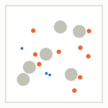

# Simple FACMAC 9a

This environment is part of the [Multi-agent worlds](families/multi-agent.md) family; its page lists the install command and the family's other environments.

| | |
|---|---|
| Creation | `pp.make("jaxmarl/MPE_simple_facmac_9a_v1")` |
| Install | `uv sync --locked --extra jaxmarl` |
| Actions | Continuous |
| Agents | `12` (9 learner-controlled, 3 scripted) |
| Action Shape | `(12, 5)` |
| Action Values | `[0, 1]` |
| Observation Shape | `(12, 40)` |
| Observation Values | `(-inf, inf)` |
| Execution | `jax` |
| Checkpointable | yes |
| Backend | `jaxmarl-0.2.0` |
| Default drift | `stationary` |
| Driftable parameters | `damping`, `mass`, `max_speed`, `rad`, `reward_multiplier`, `view_radius` |
| Default drift field | `reward_multiplier` |
| Privileged (Oracle) | `task_id`, `boundary`, drift values ([all](#privileged-fields)) |
| Upstream | [JaxMARL's MPE](https://github.com/bold-lab-ai/JaxMARL/tree/main/jaxmarl/environments/mpe) |

JaxMARL's `MPE_simple_facmac_9a_v1` through the generic `JaxMARLMPE` adapter, padded to one observation and action shape across agents, with optional scripted partner or opponent slots. FACMAC is the predator-prey task of Peng et al.'s factored multi-agent policy-gradient paper (2021): predators chase prey that move by a built-in policy. `3a`, `6a` and `9a` mean 3, 6 and 9 predators, with 1, 2 and 3 prey and 2, 4 and 6 landmarks.



*A drawing of the state after 12 random ticks, with each entity at its own radius: agents in blue, adversaries in orange and landmarks in grey.*

## Definition

### Observation Space

float32 `(agents, d)` with d = 16, 28 or 40 for 3, 6 or 9 predators: the agent's own velocity (2), its own position (2), the landmarks' positions relative to it (2 per landmark), the other agents' relative positions (2 per other agent) and 2 values for another agent's velocity (zeros for a prey). JaxMARL zeroes the landmark and other-agent blocks when the block's norm exceeds the view radius of 1.5.

### Action Space

float32 `(agents, 5)` in [0, 1], as MPE's continuous encoding: value 0 is unused, the x force is `a[2] - a[1]` and the y force `a[4] - a[3]`, multiplied by the slot's acceleration (3.0 for a predator, 4.0 for a prey).

### Rewards

float32 `(agents,)`: every predator receives the same reward, +10 for each predator-prey collision on the tick. A prey receives -10 per collision minus a penalty for nearing the map's edge.

### Respawns

The backend's episode end becomes an in-place respawn. JaxMARL ends an episode after `max_steps + 1` transitions (it checks the limit before the step counter increments), so with its default of 25 `info['respawn']` is true on ticks 26, 52, 78 and so on.

### Drift

`reward_multiplier`, the dynamics fields listed under Driftable parameters, and `scripted` (how often each scripted slot acts on purpose, in [0, 1]) via `scripted_drift=` with `num_scripted=` or `scripted_slots=`.

## Arguments

| Argument | Default |
|---|---|
| `num_scripted` | `0` |
| `scripted_slots` | `None` |
| `scripted_behavior` | `'partner'` |
| `drift` | `None` |
| `scripted_drift` | `None` |

## Usage

```python
import jax
import jax.numpy as jnp
import perpetua as pp

env = pp.make("jaxmarl/MPE_simple_facmac_9a_v1")
state, obs, info = env.init(jax.random.key(0))
for tick in range(4):
    action = jnp.zeros(env.action_space.shape, dtype=jnp.float32)
    state, obs, reward, info = env.step(state, action, jax.random.key(1000 + tick))
print(obs.shape, reward, info["t"].to_int())

# Make it non-stationary: `reward_multiplier` alternates between two values every 1,000 ticks.
drifting = pp.make(
    "jaxmarl/MPE_simple_facmac_9a_v1",
    drift={"reward_multiplier": pp.drift.Cyclic([(1,), (0.5,)], period=1000)},
)
state, obs, info = drifting.init(jax.random.key(0))
```

## Limits

The prey are moved by FACMAC's built-in policy and ignore actions, so their slots are always inactive. They are the "scripted" slots in the Agents row, which are not the optional `num_scripted` slots below. The prey's policy scores candidate moves with JaxMARL's `score_function='min'`; `MPE_simple_facmac_v1` has the same layout as 3a with `'sum'`. Scripted slots look two ticks ahead on the learners' reward; sparse rewards mostly tie, so they act nearly at random there.

## See also

The [Multi-agent RL](../marl.md) guide.

## Privileged fields

Hidden from the agent; expose any of them with `pp.Oracle(env, expose=["task_id", ...])`, which records the choice in `metadata["oracle_exposure"]`.

| Field | Meaning |
|---|---|
| `phase` | the drift phase: an integer that changes at every declared switch (for `Cyclic`, the index of the current value) |
| `drift_parameters` | the current value of the default drifting parameter |
| `drift_changed` | deprecated alias of `boundary` |
| `task_id` | the active task: the task index under a task switch, the regime under MORPHEUS, otherwise the phase of the default drifting parameter |
| `boundary` | whether a declared switch happened on this tick (the name task-sequence protocols use, for example SAC's `task_boundary_reset`) |
| `damping_parameters`, `damping_phase`, `damping_changed` | the current value, phase and switch flag of `damping` |
| `mass_parameters`, `mass_phase`, `mass_changed` | the current value, phase and switch flag of `mass` |
| `max_speed_parameters`, `max_speed_phase`, `max_speed_changed` | the current value, phase and switch flag of `max_speed` |
| `rad_parameters`, `rad_phase`, `rad_changed` | the current value, phase and switch flag of `rad` |
| `reward_multiplier_parameters`, `reward_multiplier_phase`, `reward_multiplier_changed` | the current value, phase and switch flag of `reward_multiplier` |
| `view_radius_parameters`, `view_radius_phase`, `view_radius_changed` | the current value, phase and switch flag of `view_radius` |

## Version History

- `v1`: wraps JaxMARL 0.2; the version follows JaxMARL's id.

## API

```{eval-rst}
.. autoclass:: perpetua.adapters.jaxmarl_mpe.JaxMARLMPE
   :no-index:
```
