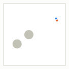

# Simple Push

This environment is part of the [Multi-agent worlds](families/multi-agent.md) family; its page lists the install command and the family's other environments.

| | |
|---|---|
| Creation | `pp.make("jaxmarl/MPE_simple_push_v3")` |
| Install | `uv sync --locked --extra jaxmarl` |
| Actions | Discrete |
| Agents | `2` |
| Action Shape | `(2,)` |
| Action Values | `Discrete(5)` per agent |
| Observation Shape | `(2, 19)` |
| Observation Values | `(-inf, inf)` |
| Execution | `jax` |
| Checkpointable | yes |
| Backend | `jaxmarl-0.2.0` |
| Default drift | `stationary` |
| Driftable parameters | `contact_margin`, `damping`, `dt`, `mass`, `reward_multiplier` |
| Default drift field | `reward_multiplier` |
| Privileged (Oracle) | `task_id`, `boundary`, drift values ([all](#privileged-fields)) |
| Upstream | [MPE2 Simple Push](https://mpe2.farama.org/environments/simple_push/) |

JaxMARL's `MPE_simple_push_v3` through the generic `JaxMARLMPE` adapter, padded to one observation and action shape across agents, with optional scripted partner or opponent slots.



*A drawing of the state after 12 random ticks, with each entity at its own radius: agents in blue, adversaries in orange and landmarks in grey.*

The observation, action and reward definitions are upstream's: see [MPE2 Simple Push](https://mpe2.farama.org/environments/simple_push/). This page lists only what changes in Perpetua.

## What changes in Perpetua

### Rewards

The backend's per-agent reward.

### Respawns

The backend's episode end becomes an in-place respawn. JaxMARL ends an episode after `max_steps + 1` transitions (it checks the limit before the step counter increments), so with its default of 25 `info['respawn']` is true on ticks 26, 52, 78 and so on.

### Drift

`reward_multiplier`, the dynamics fields listed under Driftable parameters, and `scripted` (how often each scripted slot acts on purpose, in [0, 1]) via `scripted_drift=` with `num_scripted=` or `scripted_slots=`.

## Arguments

| Argument | Default |
|---|---|
| `num_scripted` | `0` |
| `scripted_slots` | `None` |
| `scripted_behavior` | `'partner'` |
| `drift` | `None` |
| `scripted_drift` | `None` |

## Usage

```python
import jax
import perpetua as pp

env = pp.make("jaxmarl/MPE_simple_push_v3")
state, obs, info = env.init(jax.random.key(0))
for tick in range(4):
    action = pp.policies.random(obs, info, jax.random.key(100 + tick))
    state, obs, reward, info = env.step(state, action, jax.random.key(1000 + tick))
print(obs.shape, reward, info["t"].to_int())

# Make it non-stationary: `reward_multiplier` alternates between two values every 1,000 ticks.
drifting = pp.make(
    "jaxmarl/MPE_simple_push_v3",
    drift={"reward_multiplier": pp.drift.Cyclic([(1,), (0.5,)], period=1000)},
)
state, obs, info = drifting.init(jax.random.key(0))
```

## Limits

Scripted slots look two ticks ahead on the learners' reward; sparse rewards mostly tie, so they act nearly at random there.

## See also

The [Multi-agent RL](../marl.md) guide.

## Privileged fields

Hidden from the agent; expose any of them with `pp.Oracle(env, expose=["task_id", ...])`, which records the choice in `metadata["oracle_exposure"]`.

| Field | Meaning |
|---|---|
| `phase` | the drift phase: an integer that changes at every declared switch (for `Cyclic`, the index of the current value) |
| `drift_parameters` | the current value of the default drifting parameter |
| `drift_changed` | deprecated alias of `boundary` |
| `task_id` | the active task: the task index under a task switch, the regime under MORPHEUS, otherwise the phase of the default drifting parameter |
| `boundary` | whether a declared switch happened on this tick (the name task-sequence protocols use, for example SAC's `task_boundary_reset`) |
| `contact_margin_parameters`, `contact_margin_phase`, `contact_margin_changed` | the current value, phase and switch flag of `contact_margin` |
| `damping_parameters`, `damping_phase`, `damping_changed` | the current value, phase and switch flag of `damping` |
| `dt_parameters`, `dt_phase`, `dt_changed` | the current value, phase and switch flag of `dt` |
| `mass_parameters`, `mass_phase`, `mass_changed` | the current value, phase and switch flag of `mass` |
| `reward_multiplier_parameters`, `reward_multiplier_phase`, `reward_multiplier_changed` | the current value, phase and switch flag of `reward_multiplier` |

## Version History

- `v3`: wraps JaxMARL 0.2; the version follows JaxMARL's id.

## API

```{eval-rst}
.. autoclass:: perpetua.adapters.jaxmarl_mpe.JaxMARLMPE
   :no-index:
```
