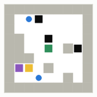

# MEAL Overcooked

This environment is part of the [Continual benchmarks](families/benchmarks.md) family; its page lists the install command and the family's other environments.

| | |
|---|---|
| Creation | `pp.make("meal/overcooked-v0")` |
| Install | `uv sync --locked --extra meal` |
| Actions | Discrete |
| Agents | `2` |
| Action Shape | `(2,)` |
| Action Values | `Discrete(6)` per agent |
| Observation Shape | `(2, 9, 9, 26)` |
| Observation Values | `(-inf, inf)` |
| Execution | `jax` |
| Checkpointable | yes |
| Backend | `meal-bench-0.3.1` |
| Default drift | `stationary` |
| Driftable parameters | `reward_multiplier` |
| Default drift field | `reward_multiplier` |
| Privileged (Oracle) | `task_id`, `boundary`, drift values ([all](#privileged-fields)) |
| Upstream | [MEAL](https://github.com/TTomilin/MEAL) |

One MEAL Overcooked layout (MIT, MEAL 0.3.1), generated through MEAL's seeded sequence API, as a continuing lifetime. `pp.presets.meal_sequence` cycles layouts.



*The kitchen after 6 random ticks: the two cooks in blue, walls and counters in grey, pots in black, the onion pile in yellow, the plate pile in purple and the delivery square in green. The layout is generated, so yours may differ.*

## Definition

### Observation Space

float32 `(agents, height, width, 26)`, channels last, one grid per cook with that cook's own layers first. As MEAL's `get_obs` documents them: channels 0-9 are own and partner position, then own and partner facing (four channels each, one per direction); 10-15 the layout (pots, counters, onion piles, tomato piles that this environment never uses, plate piles, delivery squares); 16-21 the pot state (onions waiting, tomatoes, onions cooking, tomatoes, cooking time left, soup done); 22-24 loose plates, onions and tomatoes; 25 an urgency flag that is 1 on every cell when 40 or fewer steps remain.

### Action Space

`Discrete(6)` per cook, as MEAL's `Actions`: 0 up, 1 down, 2 right, 3 left, 4 stay, 5 interact.

### Rewards

float32 `(agents,)`: MEAL's sparse reward, 20 to the cook that delivers a soup. MEAL's shaped reward is not exposed.

### Respawns

MEAL's auto-resets become respawns inside the lifetime.

### Drift

`reward_multiplier`; layout switching is a preset.

## Arguments

| Argument | Default |
|---|---|
| `difficulty` | `'medium'` |
| `num_agents` | `2` |
| `seed` | `0` |
| `backend` | `None` |
| `drift` | `None` |

## Usage

```python
import jax
import perpetua as pp

env = pp.make("meal/overcooked-v0")
state, obs, info = env.init(jax.random.key(0))
for tick in range(4):
    action = pp.policies.random(obs, info, jax.random.key(100 + tick))
    state, obs, reward, info = env.step(state, action, jax.random.key(1000 + tick))
print(obs.shape, reward, info["t"].to_int())

# Make it non-stationary: `reward_multiplier` alternates between two values every 1,000 ticks.
drifting = pp.make(
    "meal/overcooked-v0",
    drift={"reward_multiplier": pp.drift.Cyclic([(1,), (0.5,)], period=1000)},
)
state, obs, info = drifting.init(jax.random.key(0))
```

## See also

The [Benchmark setup: MEAL, Continual World and COOM](../benchmarks.md) guide.

## Privileged fields

Hidden from the agent; expose any of them with `pp.Oracle(env, expose=["task_id", ...])`, which records the choice in `metadata["oracle_exposure"]`.

| Field | Meaning |
|---|---|
| `phase` | the drift phase: an integer that changes at every declared switch (for `Cyclic`, the index of the current value) |
| `drift_parameters` | the current value of the default drifting parameter |
| `drift_changed` | deprecated alias of `boundary` |
| `task_id` | the active task: the task index under a task switch, the regime under MORPHEUS, otherwise the phase of the default drifting parameter |
| `boundary` | whether a declared switch happened on this tick (the name task-sequence protocols use, for example SAC's `task_boundary_reset`) |
| `reward_multiplier_parameters`, `reward_multiplier_phase`, `reward_multiplier_changed` | the current value, phase and switch flag of `reward_multiplier` |

## Version History

- `v0`: initial release.

## API

```{eval-rst}
.. autoclass:: perpetua.adapters.meal.MealOvercooked
   :no-index:
```
