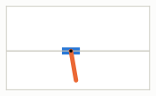

# MJX CartPole

This environment is part of the [Classic and MuJoCo control](families/control.md) family; its page lists the install command and the family's other environments.

| | |
|---|---|
| Creation | `pp.make("mjx/CartPole-v0")` |
| Install | `uv sync --locked --extra mjx` |
| Actions | Continuous |
| Agents | `1` |
| Action Shape | `(1, 1)` |
| Action Values | `[-1, 1]` |
| Observation Shape | `(1, 5)` |
| Observation Values | `(-inf, inf)` |
| Execution | `jax` |
| Checkpointable | yes |
| Backend | `mujoco-mjx-3.3.0` |
| Default drift | `stationary` |
| Driftable parameters | `gravity`, `mass_scale` |
| Default drift field | `gravity` |
| Privileged (Oracle) | `task_id`, `boundary`, drift values ([all](#privileged-fields)) |

A swing-up cart-pole on MuJoCo MJX. The cart is held by joint limits, so the pole can always be swung up again.



*A drawing of the observation after 12 random ticks (positions and angles; not a simulator render).*

## Definition

### Observation Space

float32 `(1, 5)`: cart position and velocity, cos and sin of the pole angle, angular velocity.

### Action Space

float32 `(1, 1)`: normalized force in [-1, 1].

### Rewards

float32 `(1,)`: `cos(angle) - 0.01*position**2 - 0.001*force**2`.

### Initial State

Hanging down with a small seeded perturbation.

### Respawns

None: no termination or time limit.

### Drift

`gravity` and `mass_scale`, as in `mjx/Pendulum-v0`. The slider limit of the cart responds to the scaled mass too.

## Arguments

| Argument | Default |
|---|---|
| `frame_skip` | `5` |
| `drift` | `None` |

## Usage

```python
import jax
import jax.numpy as jnp
import perpetua as pp

env = pp.make("mjx/CartPole-v0")
state, obs, info = env.init(jax.random.key(0))
for tick in range(4):
    action = jnp.zeros(env.action_space.shape, dtype=jnp.float32)
    state, obs, reward, info = env.step(state, action, jax.random.key(1000 + tick))
print(obs.shape, reward, info["t"].to_int())

# Make it non-stationary: `gravity` alternates between two values every 1,000 ticks.
drifting = pp.make(
    "mjx/CartPole-v0",
    drift={"gravity": pp.drift.Cyclic([(9.81,), (4.905,)], period=1000)},
)
state, obs, info = drifting.init(jax.random.key(0))
```

## Privileged fields

Hidden from the agent; expose any of them with `pp.Oracle(env, expose=["task_id", ...])`, which records the choice in `metadata["oracle_exposure"]`.

| Field | Meaning |
|---|---|
| `phase` | the drift phase: an integer that changes at every declared switch (for `Cyclic`, the index of the current value) |
| `drift_parameters` | the current value of the default drifting parameter |
| `drift_changed` | deprecated alias of `boundary` |
| `task_id` | the active task: the task index under a task switch, the regime under MORPHEUS, otherwise the phase of the default drifting parameter |
| `boundary` | whether a declared switch happened on this tick (the name task-sequence protocols use, for example SAC's `task_boundary_reset`) |
| `gravity_parameters`, `gravity_phase`, `gravity_changed` | the current value, phase and switch flag of `gravity` |
| `mass_scale_parameters`, `mass_scale_phase`, `mass_scale_changed` | the current value, phase and switch flag of `mass_scale` |

## Version History

- `v0`: initial release.

## API

```{eval-rst}
.. autoclass:: perpetua.adapters.mjx.MJXControl
   :no-index:
```
