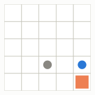

# Opponent Grid

This environment is part of the [Multi-agent worlds](families/multi-agent.md) family; its page lists the install command and the family's other environments.

| | |
|---|---|
| Creation | `pp.make("OpponentGrid-v0")` |
| Install | `uv sync --locked` |
| Actions | Discrete |
| Agents | `2` (1 learner-controlled, 1 scripted) |
| Action Shape | `(2,)` |
| Action Values | `Discrete(5)` per agent |
| Observation Shape | `(2, 7)` |
| Observation Values | `[0, 1]` |
| Execution | `jax` |
| Checkpointable | yes |
| Backend | `native JAX` |
| Default drift | `stationary` |
| Driftable parameters | `goal`, `opponent` |
| Default drift field | `goal` |
| Privileged (Oracle) | `task_id`, `boundary`, drift values ([all](#privileged-fields)) |

Learners collect a shared goal while scripted opponents with drifting aggression hunt them. Rewards are zero-sum.



*One frame after a few random ticks: the learner in blue, the scripted opponent in grey and the goal in orange.*

## Definition

### Observation Space

As `CooperativeGrid-v0`; opponent slots observe zeros.

### Action Space

Integer `(agents,)`: stay/up/down/left/right = 0/1/2/3/4. Masked or invalid actions become stay. Opponent slots allow only stay.

### Rewards

float32 `(agents,)`: +1 for collecting, -1 when caught; opponents share the negated learner sum. A learner is caught when, after the tick's moves, it is within one step (Manhattan distance 1 or less, so the same cell counts) of any opponent; a catch cancels a collection on that tick.

### Initial State

Learners spawn uniformly outside the goal cell, drawn independently, so two learners can share a cell. Opponents spawn uniformly over every cell without replacement, so two opponents never share a cell and one can start on a learner or on the goal. When only opponents propose the same free cell, the lowest slot among them moves and the others stay; a cell a learner also proposes stays empty. On the default 5-by-5 grid, 3.75% of 2,000 seeds start with the learner and the opponent on one cell and 16.8% start within catch range.

### Respawns

A caught or collecting learner respawns outside the goal, with no regard to the opponents, so it can be caught again on the next tick.

### Drift

`goal`, and `opponent` (each opponent's aggression in [0, 1]): pass `opponent_drift=` or a mapping such as `drift={"goal": ..., "opponent": ...}`.

## Arguments

| Argument | Default |
|---|---|
| `size` | `5` |
| `num_learners` | `1` |
| `num_opponents` | `1` |
| `drift` | `None` |
| `opponent_drift` | `None` |

## Usage

```python
import jax
import perpetua as pp

env = pp.make("OpponentGrid-v0")
state, obs, info = env.init(jax.random.key(0))
for tick in range(4):
    action = pp.policies.random(obs, info, jax.random.key(100 + tick))
    state, obs, reward, info = env.step(state, action, jax.random.key(1000 + tick))
print(obs.shape, reward, info["t"].to_int())

# Make it non-stationary: `goal` alternates between two values every 1,000 ticks.
drifting = pp.make(
    "OpponentGrid-v0",
    drift={"goal": pp.drift.Cyclic([(4, 4), (0, 0)], period=1000)},
)
state, obs, info = drifting.init(jax.random.key(0))
```

## Limits

`size` is at most 64, and `num_learners + num_opponents` is at most `min(32, size**2 // 2)` slots.

## See also

The [Multi-agent RL](../marl.md) guide.

## Privileged fields

Hidden from the agent; expose any of them with `pp.Oracle(env, expose=["task_id", ...])`, which records the choice in `metadata["oracle_exposure"]`.

| Field | Meaning |
|---|---|
| `phase` | the drift phase: an integer that changes at every declared switch (for `Cyclic`, the index of the current value) |
| `drift_parameters` | the current value of the default drifting parameter |
| `drift_changed` | deprecated alias of `boundary` |
| `task_id` | the active task: the task index under a task switch, the regime under MORPHEUS, otherwise the phase of the default drifting parameter |
| `boundary` | whether a declared switch happened on this tick (the name task-sequence protocols use, for example SAC's `task_boundary_reset`) |
| `goal_parameters`, `goal_phase`, `goal_changed` | the current value, phase and switch flag of `goal` |
| `opponent_parameters`, `opponent_phase`, `opponent_changed` | the current value, phase and switch flag of `opponent` |

## Version History

- `v0`: initial release.

## API

```{eval-rst}
.. autoclass:: perpetua.envs.opponent_grid.OpponentGrid
   :no-index:
```
