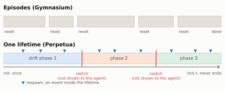

# Perpetua

Perpetua is a library of **never-ending, changing worlds** for reinforcement
learning research, and the tools to study agents that keep learning in them.
It is for researchers working on continual RL, non-stationarity, plasticity and
continual multi-agent RL, and for developers who want to add such worlds.

Three ideas differ from Gymnasium:

- **One lifetime, no resets.** `init` once, `step` forever. A death or a reached
  goal is a *respawn* event inside the lifetime, not the end of an episode.
- **Drift.** Change comes from parameters that move over time (a goal, gravity,
  a partner's behaviour), set with `drift=` when the environment is made.
  [What drifts](benchmarks.md#what-drifts) depends on the
  environment family.
- **Privilege is opt-in.** The agent is not told when the world changed; an
  `Oracle` can expose that, and the choice is recorded with the results.



```python
import perpetua as pp

# The goal alternates between two corners every 127 ticks (environment steps).
env = pp.make("ContinualGrid-v0", size=8, drift=pp.drift.Cyclic([(7, 7), (0, 0)], 127))
runner = pp.runtime.Runner(env, pp.policies.random, ticks=1024)  # 1,024 ticks, compiled
carry = runner(pp.runtime.init_lifetime(env, seed=0))
# [0]: agent slot 0. Metrics have a leading agent axis, even with one agent.
print(carry.state.t.to_int(), float(carry.metrics.mean[0]))  # ticks so far, mean reward
```

This prints `1024` and the random policy's mean reward per tick, about 0.005: random moves
rarely find the goal. The [quickstart](tutorials/quickstart.md) trains a learner instead.

## Where to go next

- **New here?** [Installation](introduction/installation.md), then the
  [concepts](introduction/concepts.md) (one page of vocabulary) and the
  [quickstart](tutorials/quickstart.md): drift, learning, recovery and
  forgetting in one five-second experiment. Coming from Gymnasium, read
  [Perpetua for Gymnasium users](introduction/gym-users.md).
- **Looking for an environment?** [Which benchmark should I use?](introduction/choosing.md)
  goes by research question; the [environments](environments/index.md) are
  grouped by family, and the [benchmarks and presets](presets/index.md) list
  the task sequences.
- **Writing an environment?** The four-step
  [custom environment tutorial](tutorials/custom-environment/index.md), checked
  with [`pp.testing.check_env`](introduction/testing.md).
- **Looking something up?** The [API reference](api/index.md) has one page per
  module.
- **Publishing?** [Reproducibility](introduction/reproducibility.md) says what
  is guaranteed, and [how to cite](introduction/citing.md) has the BibTeX.

```{toctree}
:maxdepth: 2
:hidden:
:caption: Introduction

introduction/installation
introduction/concepts
introduction/gym-users
tutorials/quickstart
usage/index
introduction/choosing
introduction/reproducibility
introduction/design-notes
introduction/faq
introduction/citing
```

```{toctree}
:maxdepth: 2
:hidden:
:caption: Writing environments

tutorials/custom-environment/index
custom-environments
introduction/testing
```

```{toctree}
:maxdepth: 2
:hidden:
:caption: API

api/index
```

```{toctree}
:maxdepth: 2
:hidden:
:caption: Environments

environments/index
environments/families/native
environments/families/multi-agent
environments/families/control
environments/families/gymnax
environments/families/benchmarks
environments/families/cpu-bridge
```

```{toctree}
:maxdepth: 2
:hidden:
:caption: Tutorials

tutorials/index
tutorials/gymnax-environment
tutorials/bean-world-ppo
tutorials/custom-drift
tutorials/task-switching
tutorials/evaluation
tutorials/reward-centering
tutorials/continual-world-sac
```

```{toctree}
:maxdepth: 2
:hidden:
:caption: Benchmarks

presets/index
benchmarks
morpheus
agarcl
```

```{toctree}
:maxdepth: 2
:hidden:
:caption: Guides

native-api
evolving-spaces
task-switching
training
training-options
tuning
evaluation
adapters
marl
```

```{toctree}
:maxdepth: 2
:hidden:
:caption: Advanced / experimental

cpu-snapshots
pettingzoo-snapshots
compute-time
```

```{toctree}
:maxdepth: 1
:hidden:
:caption: Measured claims

measurement
```
