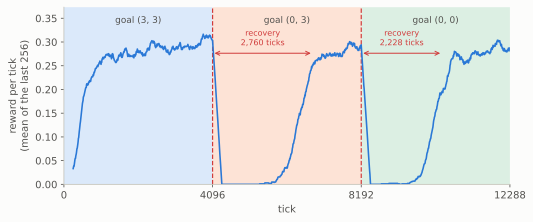

# Quickstart: your first continual-RL experiment

This page runs a complete experiment in about five seconds on a laptop CPU,
including compilation:

1. a world whose goal moves on a schedule the agent is never told about,
2. a PPO learner that keeps learning through every switch, with no resets,
3. how long it takes to recover after each switch, and
4. how much it forgot of the goals it learned earlier.

The learner needs the `training` extra. From a checkout:

```bash
uv sync --locked --extra training
uv run --extra training python quickstart.py   # the code below, saved as a file
```

```python
import jax
import jax.numpy as jnp
import numpy as np
import perpetua as pp
from perpetua.agents import PPO, PPOConfig, PPORunner

# 1. A 4x4 grid where four agents each walk to the same goal cell. The goal visits three
#    corners, staying 4,096 ticks (environment steps) at each: that is drift.
#    The four agents do not interact; they share one policy, so each tick gives
#    the learner four samples instead of one.
goals = [(3.0, 3.0), (0.0, 3.0), (0.0, 0.0)]
period = 4096
env = pp.make("ContinualGrid-v0", size=4, num_agents=4, drift=pp.drift.Cyclic(goals, period))

# 2. A continuing PPO learner. Each call runs one 64-tick rollout and one update.
#    A higher entropy bonus keeps it exploring after the goal moves (see below).
rollout = 64
config = PPOConfig(rollout_steps=rollout, entropy_coefficient=0.1)
trainer = PPORunner(env, PPO(action_size=5, config=config))
# window_size: how many recent per-tick rewards the metrics keep (read below).
train_state = trainer.init(seed=0, window_size=rollout)
rewards, saved = [], []
for update in range(1, 3 * period // rollout + 1):
    train_state = trainer(train_state)
    # The last 64 per-tick rewards (at most window_size), shape (64, agents).
    metrics = train_state.lifetime.metrics
    rewards.append(np.asarray(pp.evaluation.recent_rewards(metrics, steps=rollout)))
    if update * rollout % period == 0:
        saved.append(train_state.agent)  # the policy at the end of each goal's phase
rewards = np.concatenate(rewards).mean(axis=1)  # (12288,): mean over the four agents

# 3. Recovery. We designed the schedule, so we know the goal moved at ticks
#    4096 and 8192; the agent never sees that (it is privileged information).
#    window=256 is the averaging span for recovery, unrelated to the metrics
#    window_size above.
recovery = pp.evaluation.recovery_ticks(rewards, jnp.asarray([period, 2 * period]), window=256)
print("ticks to recover after each switch:", np.asarray(recovery).tolist())

# 4. Forgetting. Score every saved policy with the goal held at each corner,
#    on the same seeded lifetimes, in one vmapped call per corner.
#    Stack the three saved policies into one pytree with a leading axis of 3.
policies = jax.tree.map(lambda *leaves: jnp.stack(leaves), *saved)


def act(agent_state, obs, info, key):
    return trainer.agent.act(agent_state, obs, info, key).action


scores = np.zeros((3, 3))  # scores[k, j]: policy saved after phase k, goal of phase j
for j, goal in enumerate(goals):
    held = pp.make("ContinualGrid-v0", size=4, num_agents=4, drift=pp.drift.Cyclic([goal], 1))
    # Run each policy for 512 ticks on fresh lifetimes with seeds 0, 1, 2.
    means = pp.evaluation.revisit(
        held, act, policies, seeds=jnp.asarray([0, 1, 2]), ticks=512
    )  # mean reward per tick, shape (3 policies, 3 seeds)
    scores[:, j] = np.asarray(means).mean(axis=1)  # average over the seeds
print("scores (rows: saved policy, columns: goal):")
print(np.round(scores, 3))
print("forgetting:", round(float(pp.evaluation.forgetting(scores)), 3))
assert np.all(np.asarray(recovery) < period)  # it recovered after both switches
```

On CPU this prints:

```text
ticks to recover after each switch: [2760, 2228]
scores (rows: saved policy, columns: goal):
[[0.299 0.    0.   ]
 [0.001 0.286 0.001]
 [0.002 0.058 0.293]]
forgetting: 0.262
```



*The same run, drawn by `scripts/plot_docs_figures.py quickstart`: reward per
tick, averaged over the last 256 ticks. The goal moves at the dashed lines and
the arrows are the recovery times printed above.*

## How step 4 works

`saved` holds the learner's state at the end of each phase. `jax.tree.map`
with `jnp.stack` turns that list of three states into a single state whose
arrays have a leading axis of 3, so all three policies can be evaluated in one
compiled call. `held` is the same world with the goal fixed at one corner
(a `Cyclic` with a single value keeps the goal in place). `pp.evaluation.revisit` starts
fresh lifetimes from the given seeds, runs every policy in each of them
without learning, and returns the mean reward per tick for each (policy, seed)
pair. Averaging over seeds fills one column of the score matrix.

## Reading the results

- **Recovery** is the number of ticks after a switch until the first tick
  whose following 256-tick mean reward is at least 90% of the mean over the
  256 ticks before the switch. A learner that had learned nothing before the
  switch recovers trivially, in 0 ticks. Here the learner
  needs about 2,200–2,800 ticks to adapt to each new goal.
- **Scores** show the classic continual-learning pattern: each policy is good
  at the goal it was trained on last (the diagonal, about 0.29) and poor at
  the others. The final policy (last row) has almost completely forgotten the
  first goal.
- **Forgetting** is, averaged over the earlier goals, the best score any
  earlier saved policy (from that goal's phase onward) reached on a goal minus
  the final policy's score on it (Chaudhry et
  al., 2018). 0 means nothing was forgotten; here it is about 0.26, close to
  the whole score of a learned goal.

## Things to try

- **Keep the default entropy bonus** (`PPOConfig(rollout_steps=64)`, 0.01).
  With it, the policy stopped exploring and never learned the second goal in
  any of the 4 seeds we tried, though it learned the third
  ([comparing runs](evaluation.md) measures this over 8 seeds). It is a small
  example of a learner that stops adapting, the problem continual RL studies.
  For loss of plasticity in the network itself, `PPOConfig` has
  `activation="crelu"`, `l2_coefficient` and `reset_interval`.
- **Change the drift**: `pp.drift.RandomWalk(low=0, high=3, scale=0.05)` moves
  the goal gradually instead of in jumps (recovery is then undefined, because
  there is no switch; use the windowed reward instead).
- **See what the agent cannot**: wrap the world as
  `pp.Oracle(env, expose=["boundary"])` to receive the switch flag in
  `info["oracle"]`, and note that the exposure is recorded in
  `env.metadata["oracle_exposure"]`.
- **More environments**: any id from the [environment list](../environments/index.md)
  works the same way, for example `pp.make("gymnax/CartPole-v1",
  drift={"gravity": pp.drift.Cyclic([(9.8,), (15.0,)], 4096)})`.

Results come from one seed and are for illustration. For comparisons, run
several seeds and report the IQM (the mean of the middle 50% of runs) with
confidence intervals
(see [comparing runs](evaluation.md)).

Next: the [tutorials](index.md), starting with
[drifting a gymnax environment](gymnax-environment.md).
